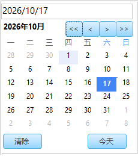
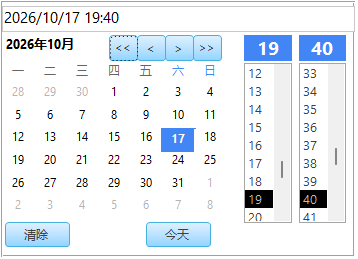
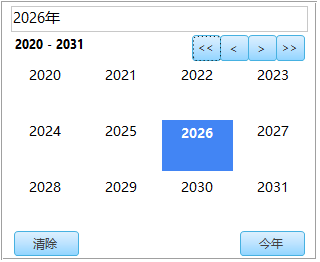
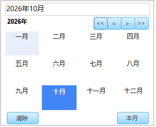
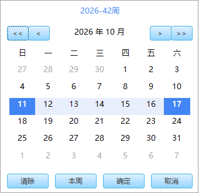
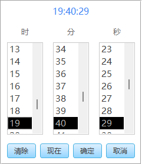
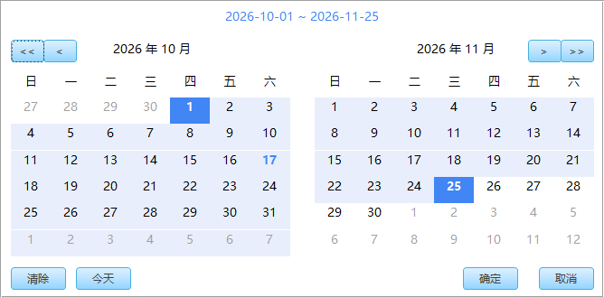
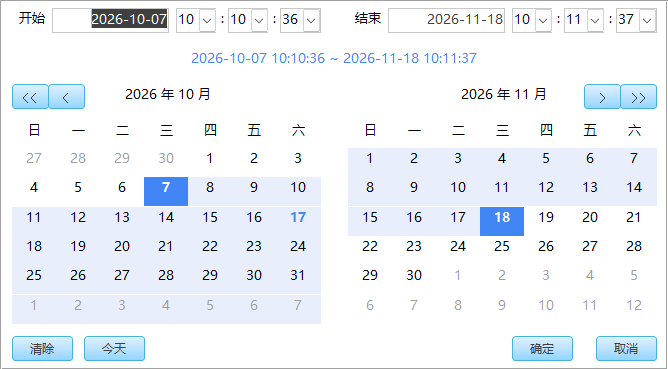

# Access DatePicker / Access 日期选择器

> 纯 VBA 实现的 Microsoft Access 日期、年月、日期范围、周、时间和时间范围选择器，零外部依赖，一键部署。
>
> Pure VBA date, year-month, date-range, week, time and date-time range pickers for Microsoft Access, with zero external dependencies and one-click deployment.

[中文](#-功能特性) | [English](#-features)


---

**日期选择器：**



**日期时间选择器：**



**年份选择器：**



**年月选择器：**



**周选择器：**



**时间选择器：**



**日期范围选择器：**



**时间范围选择器：**



---

## ✨ 功能特性

- **纯 VBA + Access 窗体实现** — 无 ActiveX，无 WebBrowser 控件，无外部库
- **日历网格** + 上/下月导航
- **时间选择器**（小时 & 分钟列表） — 可显示或隐藏
- **年份选择器** — 12 年网格，单击回写四位年份，可快速翻页及选择今年
- **年月选择器** — 十年/年份导航 + 4×3 月份网格
- **日期范围选择器** — 双月联动日历、起止日期高亮、悬停预览，点击两次完成选择
- **周选择器**：单月日历整周高亮，单击任意一天选择该周，显示如 `2026-40周`
- **独立时间选择器**：时、分、秒三列选择，预览后确认，支持纯时间 Date 或格式化文本回写
- **时间范围选择器**：双月日历与起止时分秒，选完日期后仍可调整时间，确认后回写完整日期时间
- **自动创建窗体** — 一条命令即可，无需手动设计
- **表达式事件绑定** — 窗体代码模块为零
- **下拉模式** — 可绑定任意文本框作为非模态弹出
- **双击**日期/月份格子即可确认并关闭
- 兼容 **Access 2010 / 2013 / 2016 / 2019 / 365**，32 位 & 64 位，`.accdb` & `.mdb`

## 📋 环境要求

| 依赖 | 版本要求 |
|------|----------|
| Microsoft Access | 2010 / 2013 / 2016 / 2019 / 365 |
| Windows | 7 / 8 / 10 / 11 |
| 架构 | 32 位 或 64 位均可 |
| 数据库格式 | `.accdb` 或 `.mdb` |
| 外部依赖 | 无 |

## 🚀 快速开始

直接体验：打开 [DatePicker.accdb](DatePicker.accdb) 的 `Demo` 窗体。示例按“日期 → 日期时间 → 年份 → 月份 → 周 → 时间 → 日期范围 → 时间范围”排列，输入框对齐，Tab 顺序与显示顺序一致。

单击“年份”输入框可选择独立年份，回写如 `2026` 的四位年份文本；单击“月份”可打开四列三行的中文月份面板，切换年份后单击月份即回写 `yyyy-mm`。两个入口共用 [Module_YearMonthPicker.bas](Module_YearMonthPicker.bas) 和同一窗体，不需要额外模块。

### 步骤 1：导入模块

1. 打开你的 Access 数据库（`.accdb` / `.mdb`）
2. 按 **Alt + F11** 打开 VBA 编辑器
3. 菜单选择 **文件 → 导入文件**
4. 按需选择 `Module_DatePicker.bas`、`Module_YearMonthPicker.bas`、`Module_DateRangePicker.bas`、`Module_WeekPicker.bas`、`Module_TimePicker.bas` 或 `Module_DateTimeRangePicker.bas`
5. 点击 **打开** 完成导入

### 步骤 2：创建选择器窗体

1. 在 VBA 编辑器中按 **Ctrl + G** 打开立即窗口
2. 输入以下命令并按回车：

```vb
CreateDatePickerForm
```

3. 看到 **"创建成功"** 提示框即可

> ⚠️ 此命令只需执行一次，窗体 `frmDatePicker` 会永久保存在数据库中

年月选择器也需要执行：

```vb
CreateYearMonthPickerForm
```

日期范围选择器需要导入独立模块 `Module_DateRangePicker.bas`，然后执行：

```vb
CreateDateRangePickerForm
```

该模块使用 Windows 中文 ANSI（CP936）编码，可直接导入 VBA 编辑器。示例数据库已部署范围窗体，可在 `Demo` 窗体中单击“日期范围”输入框试用。

周选择器导入 `Module_WeekPicker.bas`（CP936 编码）后执行：

```vb
CreateWeekPickerForm
```

示例数据库的 `Demo` 窗体也已加入“周”输入框，单击即可试用。

独立时间选择器导入 `Module_TimePicker.bas`（CP936 编码）后执行：

```vb
CreateTimePickerForm
```

示例数据库的 `Demo` 窗体提供“时间”输入框，支持如 `12:25:30` 的独立时间选择。

时间范围选择器导入独立的 `Module_DateTimeRangePicker.bas`（GBK/CP936 编码）后执行：

```vb
CreateDateTimeRangePickerForm
```

时间范围演示已合并到 [DatePicker.accdb](DatePicker.accdb) 的 `Demo` 窗体中，单击“时间范围”输入框即可选择起止日期和时分秒，不依赖其他选择器模块。

### 步骤 3：调用选择器

#### 日期选择器

```vb
' 选择日期+时间（默认当前时间）
Dim dt As Variant
dt = ShowDatePicker()

If Not IsNull(dt) Then
    MsgBox "您选择了: " & dt
End If
```

```vb
' 仅选择日期（隐藏时间选择器）
dt = ShowDatePicker(Now, False)
```

```vb
' 指定默认日期
dt = ShowDatePicker(#2026-2-23 15:30:00#)
```

#### 绑定文本框

```vb
Private Sub cmdPickDate_Click()
    Dim dt As Variant
    If IsNull(Me.txtDate.Value) Then
        dt = ShowDatePicker()
    Else
        dt = ShowDatePicker(Me.txtDate.Value)
    End If
    If Not IsNull(dt) Then
        Me.txtDate.Value = dt
    End If
End Sub
```

#### 年份选择器

```vb
Private Sub txtYear_Click()
    PickYearFor Me.txtYear
End Sub
```

也可以在文本框的“单击”事件中填写表达式：

```vb
=PickYearForCtl("frmOrder","txtYear")
```

默认回写四位年份文本，支持 `PickYearFor Me.txtYear, "yyyy年"` 自定义格式。清除写入 Null，取消保留原值。

#### 年月选择器

```vb
' 模态对话框
Dim dt As Variant
dt = ShowYearMonthPicker()
If Not IsNull(dt) Then
    MsgBox Format(dt, "yyyy年mm月")   ' 如 "2026年02月"
End If
```

```vb
' 绑定文本框（非模态下拉）
Private Sub txtMonth_Click()
    PickYearMonthFor Me.txtMonth, "yyyy-mm"
End Sub
```

```vb
' 在 Form_Load 中一行代码绑定
Private Sub Form_Load()
    AttachYearMonthPicker Me, "txtMonth", "yyyy年mm月"
End Sub
```

```vb
' 无代码绑定（在属性表的"双击"事件中填写表达式）
=PickYearMonthForCtl("frmOrder","txtMonth","yyyy-mm")
```

#### 日期范围选择器

```vb
' 一个文本框显示完整范围，如 2026-10-01 ~ 2026-11-30
Private Sub txtRange_Click()
    PickDateRangeFor Me.txtRange
End Sub
```

```vb
' 两个日期字段分别回写真正的 Date 值
PickDateRangeFor Me.txtStart, Me.txtEnd

' 或者在 Form_Load 中绑定双击事件
AttachDateRangePicker Me, "txtStart", "txtEnd"
```

```vb
' 模态选择，返回含两个 Date 值的数组；取消或清除返回 Null
Dim dates As Variant
dates = ShowDateRangePicker(#10/1/2026#, #11/30/2026#)
If Not IsNull(dates) Then
    Me.txtStart = dates(0)
    Me.txtEnd = dates(1)
End If
```

第一次点击选起点，第二次点击选终点并自动确认；可反向选择、选择同一天或通过导航选择跨月跨年范围。取消、Esc 或下拉模式点击外部不修改原值；“清除”会清空绑定的文本框。单框请使用未绑定文本框或文本字段，不可绑定单个日期字段。

#### 周选择器

```vb
PickWeekFor Me.txtWeek
PickWeekFor Me.txtWeekStart, True
AttachWeekPicker Me, "txtWeek"
```

默认回写 `yyyy-ww周` 文本，请使用未绑定文本框或文本字段；第二参数为 `True` 时回写该周周日的 Date 值，可绑定日期字段。也可直接在文本框的单击事件填写：

```text
=PickWeekForCtl("Demo","txtWeek")
```

周规则为周日到周六，包含 1 月 1 日的一周属于新年第 1 周，不采用 ISO 周编号。例如 `2026-40周` 对应 2026-09-27 至 2026-10-03；2020-12-27 至 2021-01-02 为 `2021-01周`。鼠标移入预览整周，单击任意日期立即确认；取消、Esc 或点击外部不修改原值。

```vb
Dim weekStart As Variant
weekStart = ShowWeekPicker(#9/30/2026#)
If Not IsNull(weekStart) Then
    Me.txtWeek = WeekPicker_WeekText(weekStart)
    Me.txtStart = weekStart
    Me.txtEnd = WeekPicker_WeekEnd(weekStart)
End If
```

#### 独立时间选择器

```vb
PickTimeFor Me.txtTime
PickTimeFor Me.txtTimeText, "hh:nn:ss"
AttachTimePicker Me, "txtTime"
```

默认写入仅含时间部分的 Date，适合日期/时间字段；将文本框的“格式”设为 `hh:nn:ss` 即可显示秒。指定 `sFormat` 时写入字符串，应使用文本字段或未绑定文本框。已有日期时间只取其时间，确认时不保留日期部分；不要用它直接修改需要保留日期的字段。

三列分别选择 00–23 时、00–59 分和秒，只有“确定”或 Enter 才回写；“现在”更新预览，“取消”、Esc 或点击外部不修改原值，“清除”写入 Null。单击事件也可直接填写：

```text
=PickTimeForCtl("Demo","txtTime")
```

```vb
Dim pickedTime As Variant
pickedTime = ShowTimePicker(TimeSerial(12, 25, 30))
If Not IsNull(pickedTime) Then
    Me.txtTime = pickedTime
End If
```

#### 时间范围选择器

```vb
' 单框默认显示 2026-10-07 10:10:36 ~ 2026-11-18 10:11:37
PickDateTimeRangeFor Me.txtRange

' 双框分别写入完整 Date，可绑定两个日期/时间字段
PickDateTimeRangeFor Me.txtStart, Me.txtEnd
AttachDateTimeRangePicker Me, "txtStart", "txtEnd"
```

单框请使用文本字段或未绑定文本框；双框显示格式可设为 `yyyy-mm-dd hh:nn:ss`。两次选日后不会自动提交，可继续调整顶部日期及两端时分秒，点“确定”或按 Enter 才回写，并按完整日期时间先后排序。“取消”、Esc 或下拉模式点击外部保留原值，“清除”写入 Null。未选日期时默认为开始 `00:00:00`、结束 `23:59:59`。

```text
=PickDateTimeRangeForCtl("Demo","txtDateTimeRange")
```

```vb
Dim period As Variant
period = ShowDateTimeRangePicker(#10/7/2026 10:10:36#, #11/18/2026 10:11:37#)
If Not IsNull(period) Then
    Me.txtStart = period(0)
    Me.txtEnd = period(1)
End If
```

## 📁 项目结构

```
access-datepicker/
├── Module_DatePicker.bas       # 日期选择器 VBA 模块（日期+时间选择）
├── Module_YearMonthPicker.bas  # 年月选择器 VBA 模块（年份+月份选择）
├── Module_DateRangePicker.bas  # 日期范围选择器 VBA 模块（双月起止日期选择）
├── Module_WeekPicker.bas       # 周选择器 VBA 模块（周日到周六整周选择）
├── Module_TimePicker.bas       # 独立时间选择器 VBA 模块（时、分、秒）
├── Module_DateTimeRangePicker.bas # 时间范围选择器（起止日期及时间，精确到秒）
├── DatePicker.accdb            # 示例 Access 数据库（含已部署的选择器窗体）
└── README.md                   # 项目说明文档
```

## 🔧 核心模块说明

### 模块概览

| 模块 | 功能 | 窗体名 |
|------|------|--------|
| `Module_DatePicker.bas` | 日期+时间选择器 | `frmDatePicker` |
| `Module_YearMonthPicker.bas` | 年月选择器 | `frmYearMonthPicker` |
| `Module_DateRangePicker.bas` | 日期范围选择器 | `frmDateRangePicker` |
| `Module_WeekPicker.bas` | 周选择器 | `frmWeekPicker` |
| `Module_TimePicker.bas` | 独立时间选择器 | `frmTimePicker` |
| `Module_DateTimeRangePicker.bas` | 时间范围选择器 | `frmDateTimeRangePicker` |

### 公开 API

#### `ShowDatePicker([dtDefault], [bShowTime])`

| 参数 | 类型 | 必填 | 默认值 | 说明 |
|------|------|------|--------|------|
| `dtDefault` | Variant | 否 | `Now` | 默认日期时间 |
| `bShowTime` | Boolean | 否 | `True` | 是否显示时间选择器 |

**返回值：** 确认时返回 `Date`，取消/清除时返回 `Null`。

#### `ShowYearMonthPicker([dtDefault])`

| 参数 | 类型 | 必填 | 默认值 | 说明 |
|------|------|------|--------|------|
| `dtDefault` | Variant | 否 | `Now` | 默认日期（取其年月部分） |

**返回值：** 所选月份第 1 天的日期（如 `2026-02-01`），或 `Null`。

#### `PickYearMonthFor(ctl, [sFormat])`

| 参数 | 类型 | 必填 | 默认值 | 说明 |
|------|------|------|--------|------|
| `ctl` | Control | 是 | — | 要绑定的文本框控件 |
| `sFormat` | String | 否 | `""` | 输出格式（默认 `yyyy-mm`） |

#### `AttachYearMonthPicker(frm, sCtlName, [sFormat])`

| 参数 | 类型 | 必填 | 默认值 | 说明 |
|------|------|------|--------|------|
| `frm` | Form | 是 | — | 窗体对象 |
| `sCtlName` | String | 是 | — | 控件名称 |
| `sFormat` | String | 否 | `""` | 输出格式 |

#### 日期范围 API

| API | 说明 |
| --- | --- |
| `ShowDateRangePicker([dtStart], [dtEnd])` | 返回 `Array(开始日期, 结束日期)`，取消/清除返回 `Null`；未指定日期时显示当前月和下月 |
| `PickDateRangeFor(ctlStart, [ctlEnd], [sFormat])` | 单框整段显示，默认 `yyyy-mm-dd ~ yyyy-mm-dd`；双框默认分别写入 Date；提供格式时写入格式化字符串 |
| `PickDateRangeForCtl(sFormName, sStartCtlName, [sEndCtlName], [sFormat])` | 供控件单击/双击事件表达式调用 |
| `AttachDateRangePicker(frm, sStartCtlName, [sEndCtlName], [sFormat])` | 为单个范围文本框或一对起止文本框绑定双击事件 |

#### 周 API

| API | 说明 |
| --- | --- |
| `ShowWeekPicker([dtDefault])` | 默认值可为日期或周标签；返回所选周日的 Date，取消/清除返回 Null |
| `PickWeekFor(ctl, [bStoreDate])` | 非模态下拉；默认写周标签，`bStoreDate=True` 时写周日的 Date |
| `PickWeekForCtl(sFormName, sCtlName, [bStoreDate])` | 供控件事件表达式调用 |
| `AttachWeekPicker(frm, sCtlName, [bStoreDate])` | 绑定文本框双击事件 |
| `WeekPicker_WeekStart(value)` / `WeekPicker_WeekEnd(value)` | 从日期或周标签取得周日/周六；非法输入返回 Null |
| `WeekPicker_WeekText(value)` | 将日期或周标签规范化为 `yyyy-ww周`，非法输入返回空字符串 |

#### 时间 API

| API | 说明 |
| --- | --- |
| `ShowTimePicker([dtDefault])` | 返回纯时间 Date，取消/清除返回 Null；空值或非法默认值使用当前时间 |
| `PickTimeFor(ctl, [sFormat])` | 非模态下拉；默认写 Date，指定格式时写字符串 |
| `PickTimeForCtl(sFormName, sCtlName, [sFormat])` | 供控件单击/双击事件表达式调用 |
| `AttachTimePicker(frm, sCtlName, [sFormat])` | 绑定文本框双击事件 |
| `CreateTimePickerForm([silent])` | 创建或重建 `frmTimePicker`；重建会覆盖该窗体的手工设计修改 |

#### 时间范围 API

| API | 说明 |
| --- | --- |
| `ShowDateTimeRangePicker([dtStart], [dtEnd])` | 返回完整日期时间的 `Array(Date, Date)`，取消/清除返回 Null；空值或非法值视为未选日期 |
| `PickDateTimeRangeFor(ctlStart, [ctlEnd], [sFormat])` | 单框默认写 `yyyy-mm-dd hh:nn:ss ~ yyyy-mm-dd hh:nn:ss`；双框默认写 Date；指定格式时写字符串 |
| `PickDateTimeRangeForCtl(sFormName, sStartCtlName, [sEndCtlName], [sFormat])` | 供控件事件表达式调用 |
| `AttachDateTimeRangePicker(frm, sStartCtlName, [sEndCtlName], [sFormat])` | 为单框或两个起止框绑定双击事件 |
| `CreateDateTimeRangePickerForm([silent])` | 创建或重建 `frmDateTimeRangePicker`，重建覆盖该窗体的手工设计修改 |

### 自定义修改

#### 修改颜色

在 `Module_DatePicker.bas` 模块顶部修改颜色常量：

```vb
Private Const CLR_BLUE As Long = 16024898   ' 主题色: RGB(66,133,244)
```

#### 修改窗体大小

运行 `CreateDatePickerForm` 前，在代码中调整布局参数：

```vb
Dim CW As Long: CW = 480   ' 格子宽度
Dim CH As Long: CH = 340   ' 格子高度
```

### 常见问题

| 问题 | 解决方法 |
|------|----------|
| `CreateDatePickerForm` 报错 | 确保数据库未以只读方式打开，关闭所有窗体后重试 |
| 时间列表不显示 | 确认调用时使用 `ShowDatePicker(Now, True)` |
| 想重新生成窗体 | 直接再次运行 `CreateDatePickerForm`，会自动删除旧窗体并重建 |
| 如何在宏中使用 | 在宏的 "RunCode" 操作中调用 `ShowDatePicker()`（宏无法接收返回值，建议用 VBA） |

## 🗺️ 路线图

- [x] 日期选择器（日历网格 + 时间列表）
- [x] 年月选择器（4×3 月份网格）
- [x] 自动创建窗体，一键部署
- [x] 表达式事件绑定，零窗体代码
- [x] 下拉模式绑定文本框
- [x] 32 位 & 64 位兼容
- [ ] 多语言支持（英文 / 日文等）
- [x] 日期范围选择（双月日历 + 起止日期）
- [x] 周选择（单月整周高亮 + 周编号）
- [x] 时间范围（双月日历 + 起止日期及时分秒）
- [ ] 自定义主题配色方案
- [ ] 周起始日设置（周一 / 周日）

## 🐛 问题反馈

如果发现 Bug 或有改进建议，请：

- 提交 [Issue](https://github.com/miaowei2/accessdevelop/issues)
- 详细描述问题或建议
- 如可能，提供复现步骤

## 📄 许可证

本项目采用 MIT 许可证 - 详见 [LICENSE](LICENSE) 文件

## 👨‍💻 作者

**缪炜（will miao）**

现任微软最有价值专家（MVP），自媒体博主（公众号Access开发）

微软官方MVP主页地址：[@MVP](https://mvp.microsoft.com/zh-CN/MVP/profile/15c78eb8-1d9d-42de-9c15-afba24ec931d)
拥有丰富的企业级开发与培训经验，曾服务多家外企及知名合资企业，包括：麦格纳电子 (Magna)、飞利浦电子 (Philips)、卡特彼勒 (Caterpillar)、硕腾 (Zoetis)等。

项目经验：深耕企业数字化解决方案，通过 Access 独立架构或者其他语言开发过 ERP（企业资源计划）、WMS（仓储管理）、MES（生产执行）、CRM（客户关系）及 HR 等核心业务系统，具备极强的实战落地能力。熟悉：VBA、C#、JavaScript、SQL等开发语言。

## 📮 联系方式

- GitHub: [@miaowei2](https://github.com/miaowei2)
- email:will.miao@edonsoft.com
- 公众号：Access开发
- B站：[@Access开发易登软件](https://space.bilibili.com/10580232?spm_id_from=333.1007.0.0)
- 公司网站：[www.edonsoft.com](http://www.edonsoft.com)

## 🙏 致谢

感谢所有使用和贡献本项目的开发者！

---

# English

> A pure VBA date picker and year-month picker for Microsoft Access — zero external dependencies, one-click deployment.


**Date Picker:**


**Date-Time Picker:**


**Year Picker:**


**Year-Month Picker:**


**Week Picker:**


**Time Picker:**


**Date-Range Picker:**


**Date-Time Range Picker:**


## ✨ Features

- **Pure VBA + Access Forms** — no ActiveX, no WebBrowser control, no external libraries
- **Calendar grid** with previous/next month navigation
- **Time picker** (hour & minute lists) — can be shown or hidden
- **Year-Month picker** with decade/year navigation and 4×3 month grid
- **Date-range picker** with linked dual-month calendars, hover preview and two-click selection
- **Week picker** with full-row hover/selection and labels such as `2026-40周`
- **Standalone time picker** with hour, minute and second lists, preview and explicit confirmation
- **Date-time range picker** with dual-month calendars, start/end times to the second and explicit confirmation
- **Auto-create forms** via a single command — no manual design needed
- **Event binding via expressions** — zero form code module required
- **Dropdown mode** — attach to any text box as a non-modal popup
- **Double-click** a date/month cell to confirm and close instantly
- Compatible with **Access 2010 / 2013 / 2016 / 2019 / 365**, 32-bit & 64-bit, `.accdb` & `.mdb`

## 📋 Requirements

| Dependency | Version |
|------------|---------|
| Microsoft Access | 2010 / 2013 / 2016 / 2019 / 365 |
| Windows | 7 / 8 / 10 / 11 |
| Architecture | 32-bit or 64-bit |
| Database format | `.accdb` or `.mdb` |
| External dependencies | None |

## 🚀 Quick Start

### Step 1: Import the Module

1. Open your Access database (`.accdb` / `.mdb`)
2. Press **Alt + F11** to open the VBA Editor
3. Go to **File → Import File**
4. Select `Module_DatePicker.bas`, `Module_YearMonthPicker.bas`, `Module_DateRangePicker.bas`, `Module_WeekPicker.bas`, `Module_TimePicker.bas`, or `Module_DateTimeRangePicker.bas` as needed
5. Click **Open**

### Step 2: Create the Picker Form

1. In the VBA Editor, press **Ctrl + G** to open the Immediate Window
2. Type the following and press Enter:

```vb
CreateDatePickerForm
```

3. A success message box will appear

> ⚠️ You only need to run this once. The form `frmDatePicker` is permanently saved in your database.

For the Year-Month Picker, also run:

```vb
CreateYearMonthPickerForm
```

For the Date-Range Picker, import the standalone CP936-encoded `Module_DateRangePicker.bas` and run:

```vb
CreateDateRangePickerForm
```

For the Week Picker, import the standalone CP936-encoded `Module_WeekPicker.bas` and run:

```vb
CreateWeekPickerForm
```

For the standalone Time Picker, import the CP936-encoded `Module_TimePicker.bas` and run:

```vb
CreateTimePickerForm
```

For the Date-Time Range Picker, import the standalone GBK/CP936-encoded `Module_DateTimeRangePicker.bas` and run:

```vb
CreateDateTimeRangePickerForm
```

Call `PickDateTimeRangeFor Me.txtRange` for combined text or `PickDateTimeRangeFor Me.txtStart, Me.txtEnd` for two Date values. Both dates and times remain editable until confirmation. Open the Demo form in [DatePicker.accdb](DatePicker.accdb) to try it. Its rows are ordered as date, date-time, year, month, week, time, date range and date-time range.

### Step 3: Use the Picker

#### Date Picker

```vb
' Pick date + time (default: now)
Dim dt As Variant
dt = ShowDatePicker()

If Not IsNull(dt) Then
    MsgBox "You selected: " & dt
End If
```

```vb
' Pick date only (no time)
dt = ShowDatePicker(Now, False)
```

```vb
' With a default date
dt = ShowDatePicker(#2026-2-23 15:30:00#)
```

#### Attach to a Text Box

```vb
Private Sub cmdPickDate_Click()
    Dim dt As Variant
    If IsNull(Me.txtDate.Value) Then
        dt = ShowDatePicker()
    Else
        dt = ShowDatePicker(Me.txtDate.Value)
    End If
    If Not IsNull(dt) Then
        Me.txtDate.Value = dt
    End If
End Sub
```

#### Year Picker

Call `PickYearFor Me.txtYear` or set the text box's On Click property to `=PickYearForCtl("frmOrder","txtYear")`. It writes a four-digit year string, clears to Null, and preserves the original value on cancel. This mode reuses the Year-Month module and form.

#### Year-Month Picker

```vb
' Modal dialog
Dim dt As Variant
dt = ShowYearMonthPicker()
If Not IsNull(dt) Then
    MsgBox Format(dt, "yyyy-mm")   ' e.g. "2026-02"
End If
```

```vb
' Bind to a text box (non-modal dropdown)
Private Sub txtMonth_Click()
    PickYearMonthFor Me.txtMonth, "yyyy-mm"
End Sub
```

```vb
' One-line binding in Form_Load
Private Sub Form_Load()
    AttachYearMonthPicker Me, "txtMonth", "yyyy-mm"
End Sub
```

```vb
' No-code binding (event expression in property sheet)
' Set the text box's On Dbl Click property to:
=PickYearMonthForCtl("frmOrder","txtMonth","yyyy-mm")
```

#### Date-Range Picker

```vb
' Single text box: yyyy-mm-dd ~ yyyy-mm-dd
PickDateRangeFor Me.txtRange

' Two date fields: real Date values, not formatted strings
PickDateRangeFor Me.txtStart, Me.txtEnd

' Modal result: Array(startDate, endDate), or Null on cancel/clear
Dim dates As Variant
dates = ShowDateRangePicker(#10/1/2026#, #11/30/2026#)
If Not IsNull(dates) Then
    Me.txtStart = dates(0)
    Me.txtEnd = dates(1)
End If
```

Click the start date, then the end date to confirm. Reverse order, same-day and cross-year ranges are supported. Cancel, Escape and clicking outside the dropdown leave inputs unchanged; Clear resets them. Single-box ranges require a text field or an unbound text box. The sample database includes a date-range input on `Demo`.

#### Week Picker

```vb
PickWeekFor Me.txtWeek
PickWeekFor Me.txtWeekStart, True
AttachWeekPicker Me, "txtWeek"
```

The default output is a `yyyy-ww周` label and requires a text field or unbound text box. Pass `True` to store a real Date for the week's Sunday. Weeks run Sunday through Saturday; the week containing January 1 is week 1 of the new year, not ISO numbering. For example, `2026-40周` spans September 27 to October 3, 2026. Click any day to confirm the whole week. Cancel, Escape and clicking outside preserve the previous value; Clear writes Null.

`ShowWeekPicker([dateOrWeekLabel])` returns Sunday's Date, or Null on cancel/clear. `WeekPicker_WeekStart`, `WeekPicker_WeekEnd` and `WeekPicker_WeekText` convert dates or labels to week boundaries and display text. The sample `Demo` includes a week input.

#### Standalone Time Picker

```vb
PickTimeFor Me.txtTime
PickTimeFor Me.txtTimeText, "hh:nn:ss"
AttachTimePicker Me, "txtTime"
```

The default output is a time-only Date. Set the text box's Format to `hh:nn:ss` to display seconds. Passing `sFormat` writes a string instead; use a text field or an unbound text box. Existing date/time values retain only their time portion, including seconds. Confirmation does not preserve the date portion, so do not use this directly on fields whose dates must remain unchanged.

Hours run from 00 to 23; minutes and seconds from 00 to 59. Selection only updates the preview. OK or Enter writes the result; Now updates the preview; Cancel, Escape and clicking outside leave inputs unchanged; Clear writes Null. The sample `Demo` includes a time input with this click expression:

```text
=PickTimeForCtl("Demo","txtTime")
```

`ShowTimePicker([dtDefault])` returns a time-only Date, or Null on cancel/clear. Missing, Null or invalid defaults use the current time.

## 📁 Project Structure

```
access-datepicker/
├── Module_DatePicker.bas       # Date picker VBA module (date + time selection)
├── Module_YearMonthPicker.bas  # Year-month picker VBA module (year + month selection)
├── Module_DateRangePicker.bas  # Date-range VBA module (dual-month calendar)
├── Module_WeekPicker.bas       # Week picker VBA module (Sunday through Saturday)
├── Module_TimePicker.bas       # Standalone time picker VBA module (hour, minute, second)
├── DatePicker.accdb            # Sample Access database (with deployed picker forms)
└── README.md                   # Project documentation
```

## 🔧 Core Module Reference

### Module Overview

| Module | Purpose | Form Name |
|--------|---------|-----------|
| `Module_DatePicker.bas` | Date + time picker | `frmDatePicker` |
| `Module_YearMonthPicker.bas` | Year-month picker | `frmYearMonthPicker` |
| `Module_DateRangePicker.bas` | Date-range picker | `frmDateRangePicker` |
| `Module_WeekPicker.bas` | Week picker | `frmWeekPicker` |
| `Module_TimePicker.bas` | Standalone time picker | `frmTimePicker` |

### Public API

#### `ShowDatePicker([dtDefault], [bShowTime])`

| Parameter | Type | Required | Default | Description |
|-----------|------|----------|---------|-------------|
| `dtDefault` | Variant | No | `Now` | Default date/time |
| `bShowTime` | Boolean | No | `True` | Show time picker |

**Returns:** `Date` on confirm, `Null` on cancel/clear.

#### `ShowYearMonthPicker([dtDefault])`

| Parameter | Type | Required | Default | Description |
|-----------|------|----------|---------|-------------|
| `dtDefault` | Variant | No | `Now` | Default date (year & month are used) |

**Returns:** First day of selected month (e.g. `2026-02-01`), or `Null`.

#### `PickYearMonthFor(ctl, [sFormat])`

| Parameter | Type | Required | Default | Description |
|-----------|------|----------|---------|-------------|
| `ctl` | Control | Yes | — | Text box control to bind |
| `sFormat` | String | No | `""` | Output format (default `yyyy-mm`) |

#### `AttachYearMonthPicker(frm, sCtlName, [sFormat])`

| Parameter | Type | Required | Default | Description |
|-----------|------|----------|---------|-------------|
| `frm` | Form | Yes | — | Form object |
| `sCtlName` | String | Yes | — | Control name |
| `sFormat` | String | No | `""` | Output format |

### Customization

#### Colors

Edit the constants at the top of `Module_DatePicker.bas`:

```vb
Private Const CLR_BLUE As Long = 16024898   ' Theme color: RGB(66,133,244)
```

#### Form Size

Modify the layout variables inside `CreateDatePickerForm` before running it:

```vb
Dim CW As Long: CW = 480   ' Cell width
Dim CH As Long: CH = 340   ' Cell height
```

## 🗺️ Roadmap

- [x] Date picker (calendar grid + time list)
- [x] Year-month picker (4×3 month grid)
- [x] Auto-create forms, one-click deployment
- [x] Expression-based event binding, zero form code
- [x] Dropdown mode bound to text box
- [x] 32-bit & 64-bit compatibility
- [ ] Multi-language support (English / Japanese, etc.)
- [ ] Date range selection (start & end dates)
- [ ] Custom color theme presets
- [ ] Week start day setting (Monday / Sunday)

## 🐛 Bug Reports

If you find a bug or have a suggestion:

- Submit an [Issue](https://github.com/miaowei2/accessdevelop/issues)
- Describe the problem or suggestion in detail
- Include reproduction steps if possible

## 📄 License

This project is licensed under the MIT License — see the [LICENSE](LICENSE) file for details.

## 👨‍💻 Author

**Will Miao (缪炜)**

Microsoft Most Valuable Professional (MVP) and content creator (WeChat Official Account: Access开发).

Microsoft MVP profile: [@MVP](https://mvp.microsoft.com/zh-CN/MVP/profile/15c78eb8-1d9d-42de-9c15-afba24ec931d)

Extensive experience in enterprise-level development and training, having served multinational and joint-venture companies including Magna Electronics, Philips, Caterpillar, Zoetis, among others.

Specializes in enterprise digital solutions, having independently architected or co-developed ERP, WMS, MES, CRM, and HR systems using Access and other technologies. Proficient in VBA, C#, JavaScript, SQL, and more.

## 📮 Contact

- GitHub: [@miaowei2](https://github.com/miaowei2)
- Email: will.miao@edonsoft.com
- WeChat Official Account: Access开发
- Bilibili: [@Access开发易登软件](https://space.bilibili.com/10580232?spm_id_from=333.1007.0.0)
- Website: [www.edonsoft.com](http://www.edonsoft.com)

## 🙏 Acknowledgments

Thanks to all developers who use and contribute to this project!